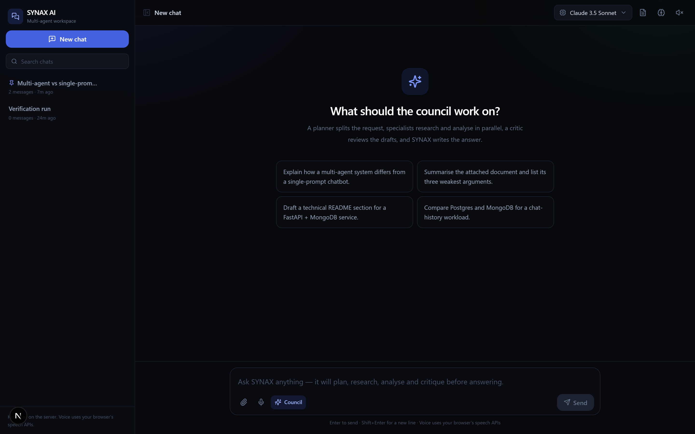
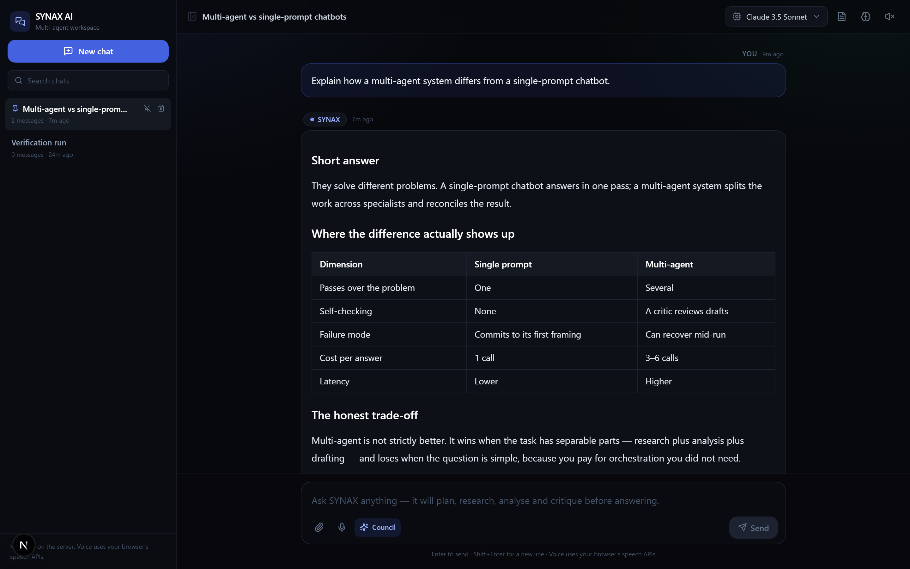
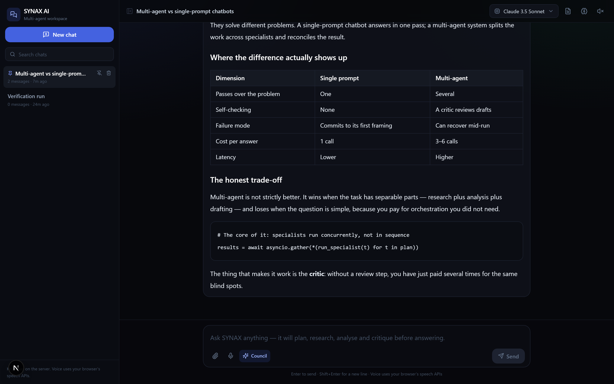
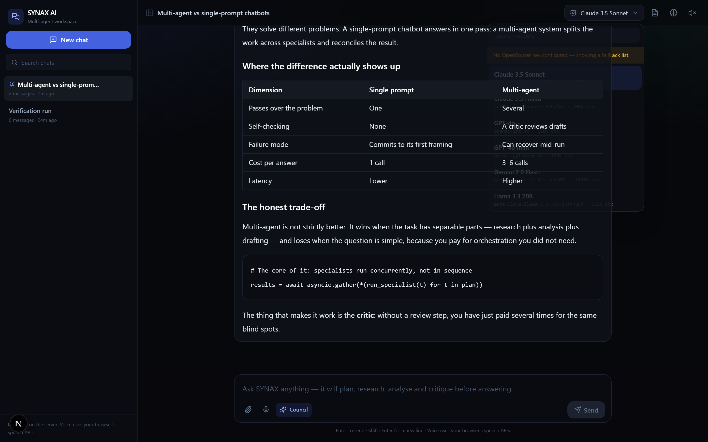
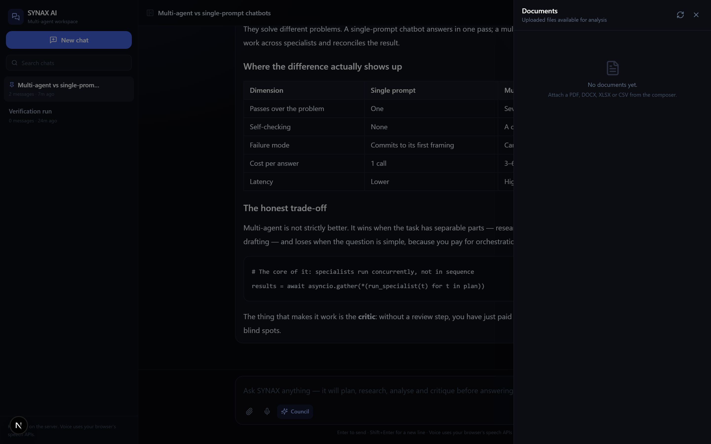
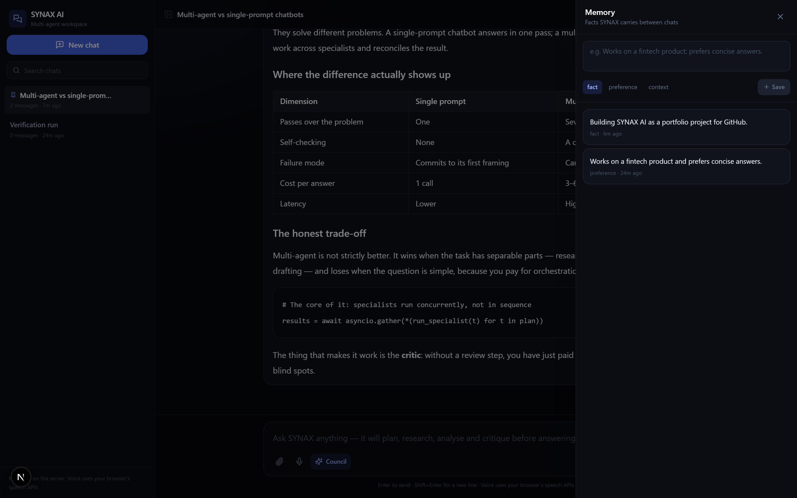

# SYNAX AI

A multi-agent AI workspace. You ask a question; a council of agents plans it, researches it, analyses it, critiques the drafts, and then writes the answer you actually see.

Built as a web application: **Next.js + TypeScript + Tailwind** on the front, **FastAPI + MongoDB** on the back, **OpenRouter** for model access, and the browser's own speech APIs for voice.

> **Status:** working application, not a mockup. Every feature in the list below is implemented and exercised by the test suite.

---

## Table of contents

- [Why this exists](#why-this-exists)
- [Features](#features)
- [Architecture](#architecture)
- [How a request flows](#how-a-request-flows)
- [Tech stack](#tech-stack)
- [Quick start](#quick-start)
- [Configuration](#configuration)
- [API reference](#api-reference)
- [Project structure](#project-structure)
- [Testing](#testing)
- [Screenshots](#screenshots)
- [Security notes](#security-notes)
- [Deployment](#deployment)
- [License](#license)

---

## Why this exists

Most "AI chat" projects are a text box wired straight to one model. That answers easy questions well and falls apart on anything that needs more than one pass: the model commits to its first framing, never checks itself, and never tells you what it was unsure about.

SYNAX AI is the other shape. The work is split across agents with different jobs, and the final answer is written *after* a critic has had a go at the drafts.

## Features

**Multi-agent council**
- A **planner** reads the request and decides which specialists are actually needed (1–3 tasks, never a fixed pipeline).
- **Researcher**, **Analyst** and **Writer** run in parallel, each on its own brief.
- A **critic** reviews the drafts and lists required fixes.
- A **synthesizer** writes the final answer, addressing the critique.
- The UI shows the live trace: which agent ran, on which model, how long it took, and where it failed.
- Toggle to **Direct** mode for a single-model answer when you don't need the council.

**Chat**
- Persistent conversations in MongoDB, with history, pinning, search and delete.
- Per-conversation model selection from the live OpenRouter catalogue.
- Markdown rendering with tables, code blocks and copy-to-clipboard.
- Optimistic sends, so the UI never feels like it's waiting on a round trip.

**Documents**
- Upload PDF, DOCX, XLSX, CSV, JSON, Markdown and plain text.
- Text is extracted server-side (pypdf, python-docx, openpyxl) and injected into the agent context.
- Attach an uploaded document to any message; the council analyses it as data, never as instructions.

**Memory**
- Durable facts the assistant carries between conversations.
- Lexically ranked against the current question, so only relevant memories enter the prompt.

**Voice**
- Speech-to-text through `SpeechRecognition`, text-to-speech through `speechSynthesis`.
- Speak a message instead of typing it; optionally have answers read aloud.
- Degrades cleanly: the mic button only appears in browsers that support it.

**Interface**
- Desktop-first responsive layout, dark by default.
- Sidebar with conversation history, slide-over panels for documents and memory.
- Keyboard-first composer: Enter to send, Shift+Enter for a newline.

## Architecture

```
┌──────────────────────────────────────────────────────────────┐
│  Browser                                                     │
│  Next.js 15 (App Router) · React 19 · TypeScript · Tailwind  │
│  · Web Speech API for voice                                  │
└───────────────────────────┬──────────────────────────────────┘
                            │  same-origin /api/*  (no keys in the bundle)
┌───────────────────────────▼──────────────────────────────────┐
│  Next.js route handler  app/api/[...path]/route.ts           │
│  server-side proxy — attaches the bearer token if configured │
└───────────────────────────┬──────────────────────────────────┘
                            │  HTTP
┌───────────────────────────▼──────────────────────────────────┐
│  FastAPI                                                     │
│  routers/  chat · conversations · documents · memory · models│
│  services/ council · openrouter · documents · memory         │
└──────────┬──────────────────────────────┬────────────────────┘
           │                              │
┌──────────▼───────────┐      ┌───────────▼────────────────────┐
│  MongoDB             │      │  OpenRouter                    │
│  conversations       │      │  planner / researcher /        │
│  messages            │      │  analyst / writer / critic /   │
│  documents           │      │  synthesizer                   │
│  memories            │      └────────────────────────────────┘
│  runs                │
└──────────────────────┘
```

The OpenRouter key exists only in the FastAPI process. The browser never receives it, and the Next.js proxy is the only thing the client talks to.

## How a request flows

1. The browser `POST`s to `/api/chat` (same origin).
2. The Next.js proxy forwards it to FastAPI, attaching the bearer token if one is configured.
3. FastAPI resolves the conversation, loads the last 12 turns, pulls relevant memories, and extracts text from any attached documents.
4. The **planner** returns JSON describing which specialists to run and what each should do.
5. The specialists run **concurrently** via `asyncio.gather`.
6. The **critic** reviews their notes.
7. The **synthesizer** writes the final answer.
8. The user turn, the assistant turn, the step trace and the token usage are all persisted.
9. The response returns the answer plus the step trace, which the UI renders as the council timeline.

If the planner fails, the council falls back to a default plan. If every specialist fails, it answers directly. If the provider is unreachable, the API returns a `503` with a readable message instead of a stack trace.

## Tech stack

| Layer | Choice | Why |
|---|---|---|
| Frontend | Next.js 15, React 19, TypeScript | App Router, server-side proxy, typed end to end |
| Styling | Tailwind CSS 3 | Design system without a component-library dependency |
| Icons | lucide-react | Small, tree-shakeable |
| Markdown | react-markdown + remark-gfm | Tables and code blocks render properly |
| Backend | FastAPI + Pydantic v2 | Async, typed, self-documenting |
| Database | MongoDB via Motor | Documents map naturally to chat turns and extracted text |
| Models | OpenRouter | One API for many providers, no vendor lock-in |
| Voice | Web Speech API | No third-party service, no extra key |
| Tests | pytest + mongomock-motor | Runs with no database server and no network |

## Quick start

**Requirements:** Node.js 20+, Python 3.11+, and MongoDB 6+ (local, Docker, or Atlas).

### 1. Clone

```bash
git clone https://github.com/<your-username>/synax-ai.git
cd synax-ai
```

### 2. Start MongoDB

With Docker:

```bash
docker compose up -d
```

Or point `MONGODB_URI` at an existing instance or an Atlas cluster.

### 3. Backend

```bash
cd backend
python -m venv .venv
# Windows
.venv\Scripts\activate
# macOS / Linux
source .venv/bin/activate

pip install -r requirements.txt
cp .env.example .env        # then edit .env and add your OpenRouter key
uvicorn app.main:app --reload --port 8000
```

The API is at `http://localhost:8000`, interactive docs at `http://localhost:8000/docs`.

### 4. Frontend

In a second terminal:

```bash
cd frontend
npm install
cp .env.example .env.local
npm run dev
```

Open `http://localhost:3000`.

### 5. Get an OpenRouter key

Create one at [openrouter.ai/keys](https://openrouter.ai/keys) and put it in `backend/.env`:

```env
OPENROUTER_API_KEY=sk-or-v1-...
```

Restart the API. Without a key the app still loads and the model picker shows a fallback list, but chat requests return a clear error.

## Configuration

### `backend/.env`

| Variable | Default | Purpose |
|---|---|---|
| `OPENROUTER_API_KEY` | — | **Required.** Server-side only. |
| `OPENROUTER_BASE_URL` | `https://openrouter.ai/api/v1` | Provider endpoint |
| `OPENROUTER_SITE_URL` | `http://localhost:3000` | Sent as `HTTP-Referer` |
| `OPENROUTER_SITE_NAME` | `SYNAX AI` | Sent as `X-Title` |
| `SYNAX_PLANNER_MODEL` | `anthropic/claude-3.5-sonnet` | Planner model |
| `SYNAX_RESEARCHER_MODEL` | `perplexity/llama-3.1-sonar-large-128k-online` | Researcher model |
| `SYNAX_ANALYST_MODEL` | `anthropic/claude-3.5-sonnet` | Analyst model |
| `SYNAX_WRITER_MODEL` | `anthropic/claude-3.5-sonnet` | Writer model |
| `SYNAX_CRITIC_MODEL` | `openai/gpt-4o-mini` | Critic model |
| `SYNAX_DEFAULT_MODEL` | `anthropic/claude-3.5-sonnet` | Synthesizer / direct mode |
| `MONGODB_URI` | `mongodb://localhost:27017` | Database connection |
| `MONGODB_DB` | `synax` | Database name |
| `CORS_ORIGINS` | `http://localhost:3000` | Comma-separated allowed origins |
| `MAX_UPLOAD_MB` | `20` | Upload ceiling |
| `UPLOAD_DIR` | `./uploads` | Where uploads are written |
| `SYNAX_API_TOKEN` | *(empty)* | If set, every request needs `Authorization: Bearer <token>` |

Any agent model can be swapped independently — that's the point of the per-agent config.

### `frontend/.env.local`

| Variable | Default | Purpose |
|---|---|---|
| `SYNAX_API_URL` | `http://127.0.0.1:8000` | Where the proxy forwards |
| `SYNAX_API_TOKEN` | *(empty)* | Must match the backend token if one is set |

## API reference

| Method | Path | Purpose |
|---|---|---|
| `GET` | `/health` | Database and provider status |
| `GET` | `/api/conversations` | List conversations |
| `POST` | `/api/conversations` | Create a conversation |
| `GET` | `/api/conversations/{id}` | Read one |
| `PATCH` | `/api/conversations/{id}` | Rename, pin, change model |
| `DELETE` | `/api/conversations/{id}` | Delete with its messages |
| `GET` | `/api/conversations/{id}/messages` | Message history |
| `DELETE` | `/api/conversations/{id}/messages` | Clear history |
| `POST` | `/api/chat` | Send a message, run the council |
| `POST` | `/api/documents` | Upload and extract a document |
| `GET` | `/api/documents` | List documents |
| `DELETE` | `/api/documents/{id}` | Delete a document |
| `GET` | `/api/memory` | List memories |
| `POST` | `/api/memory` | Save a memory |
| `DELETE` | `/api/memory/{id}` | Delete a memory |
| `GET` | `/api/models` | Model catalogue for the picker |

Full interactive schema at `/docs` when the API is running.

## Project structure

```
synax-ai/
├── backend/
│   ├── app/
│   │   ├── main.py               FastAPI app, CORS, lifespan
│   │   ├── config.py             Pydantic settings from env
│   │   ├── db.py                 Mongo client, indexes
│   │   ├── deps.py               Auth + database dependencies
│   │   ├── schemas.py            Request/response models
│   │   ├── routers/
│   │   │   ├── chat.py           The council endpoint
│   │   │   ├── conversations.py  CRUD + history
│   │   │   ├── documents.py      Upload and extraction
│   │   │   ├── memory.py         Durable facts
│   │   │   ├── models.py         Model catalogue proxy
│   │   │   └── health.py         Status
│   │   └── services/
│   │       ├── council.py        Planner → specialists → critic → synth
│   │       ├── openrouter.py     Provider client
│   │       ├── documents.py      PDF/DOCX/XLSX/CSV extraction
│   │       └── memory.py         Memory ranking
│   ├── tests/                    26 tests, no network required
│   ├── requirements.txt
│   └── .env.example
├── frontend/
│   ├── app/
│   │   ├── layout.tsx            Metadata, fonts, shell
│   │   ├── page.tsx              The workspace
│   │   ├── globals.css           Tailwind + markdown styles
│   │   └── api/[...path]/route.ts  Server-side proxy
│   ├── components/               Workspace, Sidebar, Composer, panels
│   ├── hooks/                    useChat, useVoice
│   ├── lib/                      api client, types, utils
│   └── .env.example
├── docker-compose.yml            MongoDB for local dev
├── LICENSE
└── README.md
```

## Testing

```bash
cd backend
pytest -q
```

26 tests covering planner JSON parsing (including malformed output), document extraction for every supported format, memory ranking, and the API surface. They use an in-memory Mongo, so no database server and no API key are needed.

Frontend:

```bash
cd frontend
npx tsc --noEmit     # type check
npm run build        # production build
```

## Screenshots

| Empty state with starter prompts | Answer with markdown, tables and code |
|---|---|
|  |  |

| Council output, scrolled to the end | Model picker |
|---|---|
|  |  |

| Documents panel | Memory panel |
|---|---|
|  |  |

Regenerate them at any time with the app running:

```bash
cd frontend
node scripts/screenshots.mjs
```

## Security notes

- **No secrets in the client.** The OpenRouter key lives only in the FastAPI process. The browser talks to a same-origin proxy.
- **No committed secrets.** `.env` and `.env.local` are git-ignored; only `.env.example` files are tracked.
- **Document content is data.** Uploaded text is injected as context, never executed as instructions.
- **Uploads are validated** by extension and size before anything is written, and extraction failures delete the stored file.
- **Optional bearer auth.** Set `SYNAX_API_TOKEN` on the backend and the matching value on the frontend to require a token on every request.
- **CORS is explicit.** Only the origins in `CORS_ORIGINS` are allowed.
- **No auth on conversations by default.** This is a single-user local app. Before deploying publicly, put real authentication in front of it and scope documents to the authenticated user.

## Deployment

**Frontend → Vercel.** Import the repo, set the root directory to `frontend`, and add `SYNAX_API_URL` (your backend's public URL) plus `SYNAX_API_TOKEN` if you use one.

**Backend → Render / Railway / Fly.io.** Deploy `backend/` with `uvicorn app.main:app --host 0.0.0.0 --port $PORT`. Set the environment variables from `.env.example`, and set `CORS_ORIGINS` to your deployed frontend origin.

**Database → MongoDB Atlas.** Create a free cluster, copy the connection string into `MONGODB_URI`, and allow your backend's egress IPs.

## License

MIT — see [LICENSE](LICENSE).
